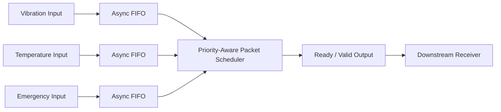

# System Architecture

## 1. Overview

The **Priority-Aware Multi-Clock Industrial Telemetry Concentrator** is a SystemVerilog RTL design that collects packet-based telemetry from three independent input channels and forwards the packets through a shared output interface.

The system supports asynchronous input clock domains, packet buffering, priority-aware scheduling, and ready/valid output flow control.

The three input channels are:

- Vibration
- Temperature
- Emergency

Each input channel has an independent asynchronous FIFO buffer. A shared packet scheduler selects packets from these buffers and transfers them to the output interface.

## 2. High-Level Architecture



## 3. Input Channel Architecture

The system receives packets from three independent input channels.

Each channel has its own clock domain and FIFO buffer:

| Channel | Description | Priority |
|---|---|---|
| Vibration | Vibration sensor telemetry | Normal |
| Temperature | Temperature sensor telemetry | Normal |
| Emergency | Emergency event telemetry | Highest |

The independent input clocks allow the channels to operate at different rates.

Each channel's FIFO provides temporary packet storage when the scheduler or downstream interface cannot immediately accept a packet.

## 4. Asynchronous FIFO Architecture

Each input channel uses an asynchronous FIFO with the following configuration:

| Parameter | Value |
|---|---:|
| Data width | 44 bits |
| Address width | 4 bits |
| FIFO depth | 16 entries |

The FIFO architecture includes:

- Write pointer logic
- Read pointer logic
- Binary-to-Gray pointer conversion
- Clock-domain synchronizers
- FIFO memory
- Full and empty status generation

The write and read sides operate using their respective clock domains. Gray-coded pointers are synchronized across clock domains to support safe pointer exchange in the RTL implementation.

The FIFO buffers decouple incoming packet timing from scheduler and output timing.

## 5. Packet Format

Each packet is 44 bits wide.

| Field | Bit Range | Width |
|---|---|---:|
| Channel ID | `[43:42]` | 2 bits |
| Packet Type | `[41:40]` | 2 bits |
| Sequence Number | `[39:32]` | 8 bits |
| Payload | `[31:0]` | 32 bits |

### Channel Encoding

| Channel ID | Channel |
|---|---|
| `2'b00` | Vibration |
| `2'b01` | Temperature |
| `2'b10` | Emergency |
| `2'b11` | Reserved |

The packet type field supports four encodings, resulting in 12 valid channel/type combinations across the three implemented channels.

## 6. Packet Scheduler

The packet scheduler arbitrates among the three FIFO buffers.

Its scheduling policy is designed to balance emergency priority with fairness for normal traffic.

### Emergency Priority

- Emergency packets receive the highest scheduling priority.
- The scheduler can serve up to two consecutive emergency packets while normal traffic is waiting.
- After the emergency burst limit is reached, a waiting normal packet is selected.

### Normal Channel Fairness

- Vibration and temperature are treated as normal-priority channels.
- Round-robin arbitration is used between these two channels.
- This prevents one continuously active normal channel from monopolizing normal traffic service.

### Packet-Level Grant Locking

Once packet transmission begins, the scheduler maintains the active grant until that packet completes.

This prevents packet-level arbitration changes from interrupting an active output packet.

## 7. Output Interface

The scheduler forwards selected packets through a ready/valid interface.

The output transfer occurs when both signals are asserted:

```systemverilog
out_valid && out_ready
```

The interface supports downstream backpressure.

When the downstream receiver deasserts `out_ready` while `out_valid` is asserted, the output packet and its associated valid indication must remain stable until the transfer can complete, subject to reset behavior.

## 8. Reset and Backpressure Handling

The verification environment exercises reset and backpressure scenarios.

Important behaviors include:

- Input buffering when output transfers are delayed.
- FIFO full and empty conditions.
- Producer stalls when input buffers cannot accept more packets.
- Output data stability during backpressure.
- Reset during output backpressure.
- Recovery after reset.

The regression includes reset scenarios, so packet counts accumulated over the complete simulation may differ between accepted and received totals. Individual scoreboard checks are used to verify the expected behavior of the tested scenarios.

## 9. RTL Module Organization

### FIFO RTL

| Module | Responsibility |
|---|---|
| `async_fifo.sv` | Asynchronous FIFO integration |
| `fifo_mem.sv` | FIFO storage |
| `write_pointer.sv` | Write pointer and full detection |
| `read_pointer.sv` | Read pointer and empty detection |
| `synchronizer.sv` | Clock-domain pointer synchronization |

### System RTL

| Module | Responsibility |
|---|---|
| `sensor_packet_buffer.sv` | Input channel packet buffering |
| `packet_scheduler.sv` | Priority and fairness arbitration |
| `telemetry_concentrator.sv` | Top-level integration |

## 10. End-to-End Packet Flow

1. A sensor channel generates a 44-bit telemetry packet.
2. The packet is written into that channel's asynchronous FIFO.
3. FIFO status signals indicate whether data is available.
4. The scheduler examines the available channels.
5. Emergency priority and normal-channel round-robin policy determine the selected source.
6. The scheduler locks the selected grant for the active packet.
7. The packet is presented on the ready/valid output interface.
8. The packet transfer completes when both `out_valid` and `out_ready` are asserted.

## 11. Design Goals

The architecture aims to provide:

- Independent buffering for multiple asynchronous input channels.
- Priority-aware packet scheduling.
- Fairness between normal-priority channels.
- Bounded consecutive emergency service under the specified scheduling policy.
- Stable output behavior under downstream backpressure.
- Modular RTL suitable for simulation-based design verification.